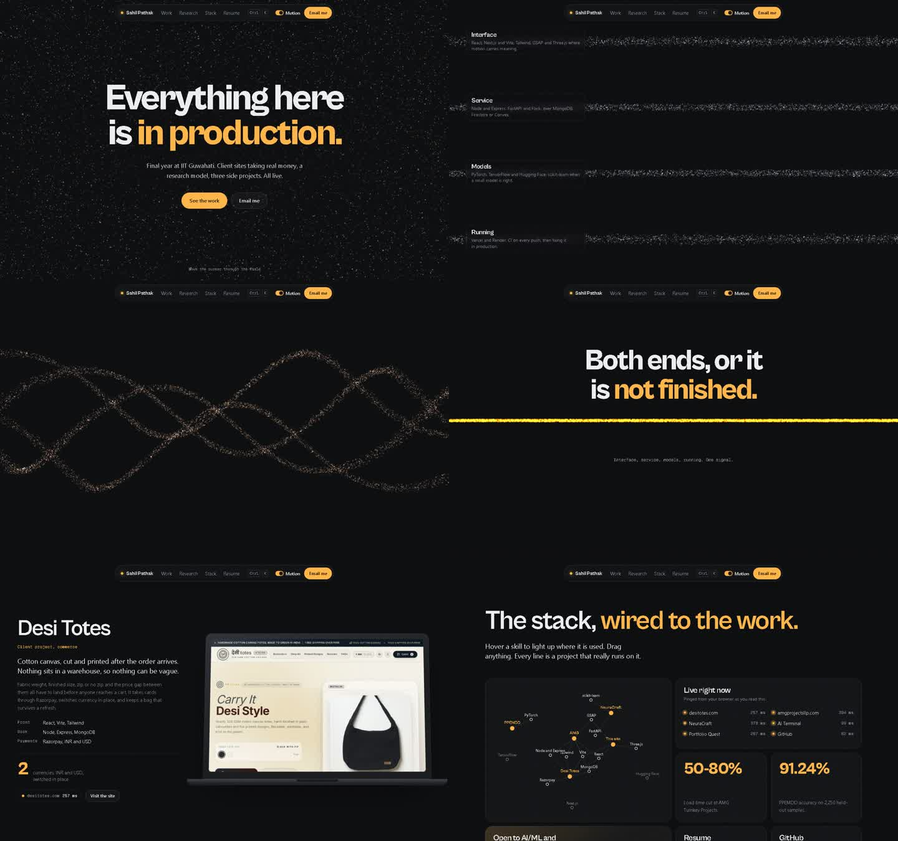

# Sahil Pathak

Portfolio of an AI/ML and full-stack engineer. Dark, one amber signal. A WebGL particle field reacts to the cursor, then on scroll splits into four strands (Interface, Service, Models, Running), braids them and fuses them into one beam: "Both ends, or it is not finished." The same fusion is the research: four signals, one gated answer.



**The work**, all live

| | |
|---|---|
| [desitotes.com](https://desitotes.com) | Desi Totes, made-to-order cotton canvas totes. Client |
| [amgprojectsllp.com](https://amgprojectsllp.com) | AMG Turnkey Projects LLP, construction and interiors, Pune. Client |
| [ai-compiler-eta.vercel.app](https://ai-compiler-eta.vercel.app) | NeuraCraft, a browser code editor ([code](https://github.com/sahil454521/AiCompiler)) |
| [sarkari-saathi-kjgb.onrender.com](https://sarkari-saathi-kjgb.onrender.com) | Sarkari Saathi, find government schemes by talking in Marathi, Hindi or English ([code](https://github.com/sahil454521/sarkari-saathi)) |
| [ai-chat-bot-gcar.vercel.app](https://ai-chat-bot-gcar.vercel.app) | AI Terminal, ask about any web page ([code](https://github.com/sahil454521/ai-chat-bot)) |
| [gamifyport.vercel.app](https://gamifyport.vercel.app) | Portfolio Quest, a pixel-art portfolio you walk around |

## The chapters

| Chapter | What it does |
|---|---|
| Hero | Who, which degrees and what he is looking for, over a particle field (Three.js shader, 14k points) that parts around the cursor |
| The work, at a glance | Every project in one line, right under the hero: what it is, what it does, the stack, and links to its story, the live thing and the code |
| Braid | Pinned, scrubbed: the field becomes four labelled strands, a braid, then one beam |
| Desi Totes, AMG | Pinned split: a CSS 3D laptop lid opens on scroll onto the real site, stats count up, live status from the API |
| Sarkari Saathi | The same split with two phones: real screens of the app mid-conversation and on its results |
| X-ray | A lens over the live site shows what is underneath: Razorpay, the cart that survives a refresh, INR and USD, the APIs behind AMG |
| PPEMDD | Switch any of the four signals off; the gate reweights the rest and signals keep flowing |
| Stack | A draggable skill constellation (d3-force): click a project to pull its stack in, click a skill to see where it runs, filter by layer. Only real skill-to-project links |
| Also live | The three side projects as a horizontal accordion |
| Resume | Cards that stack as you scroll; the full CV is `cv.html`, the PDF in `public/assets` |

Three.js and the command menu load after the first paint, so the headline never waits for them.

Plus a Cmd/Ctrl+K command menu (cmdk), Lenis smooth scroll on GSAP's ticker, magnetic buttons, and a Motion switch in the nav. Motion follows `prefers-reduced-motion`; reduced-motion visitors get a calm version and a notice offering full motion. `?motion` in the URL forces it on.

## Running it

A React front end over a Node and Express API, built with Vite.

```bash
npm install
npm run dev        # the site and the API together, http://localhost:4500
npm run build      # production build into dist/ (index.html and cv.html)
npm run preview    # serve the production build, API included
```

On Vercel the front end is the Vite build and the API is one serverless function (`api/index.js`) running the same Express app.

### The API

| Route | What it does |
|---|---|
| `GET /api/status` | Fetches every live project from the server and times it; cached at the edge for a minute. The page's live readings and the Check again button use it |
| `POST /api/contact` | Sends an email form. Needs `RESEND_API_KEY` set on Vercel; without it the caller is told to fall back to mailto. Not used by the current page, kept for later |
| `GET /api/health` | Whether the API is up, and whether mail is configured |

## What is in here

| Path | What it is |
|---|---|
| `index.html`, `src/main.jsx`, `src/App.jsx` | The React app |
| `src/data.js` | Every fact, link, metric and skill link the page shows, in one place |
| `src/motion.js` | Motion preference, Lenis on the GSAP ticker, the live status store |
| `src/components/SignalField.jsx` | The WebGL particle field and its four states |
| `src/components/` | The chapters (`Chapters.jsx`: hero, braid, cases), the index (`Index.jsx`), the nav (`Chrome.jsx`) and the command menu (`CommandMenu.jsx`, loaded on demand) |
| `src/styles.css` | The whole design system |
| `cv.html`, `src/styles/site.css` | The resume as plain, printable HTML, with its own stylesheet |
| `server/`, `api/index.js` | The Express app, the status checker and the Vercel function |
| `public/work/` | Stills of the live sites, and Sarkari Saathi's screens (`saathi-*.jpg`, made by `scrollcraft/lab/saathi-shots.mjs` from the app's own recorded output) |
| `public/assets/` | The resume's fonts and PDF |
| `docs/spec.md` | The design spec for this version |
| `legacy/` | The first React portfolio, kept intact |
| `scrollcraft/` | Brief and browser test scripts; `lab/recruiter.mjs`, `bundle.mjs`, `perf.mjs` and `shots-key.mjs` check this version |

## Checking a change

```bash
npm run build && npm run preview
node scrollcraft/lab/recruiter.mjs http://localhost:4500            # first screen, index, Saathi case, phone widths; add --reduced
node scrollcraft/lab/bundle.mjs                                     # script the first paint waits for, gzipped (budget 150 kB)
node scrollcraft/lab/perf.mjs http://localhost:4500                 # phone, 4x CPU, 4G: largest paint within 2.5 s
node scrollcraft/lab/a11y.mjs http://localhost:4500                 # tab order, headings, alt text, no em dashes
node scrollcraft/lab/shots-key.mjs http://localhost:4500            # key frames into scrollcraft/lab/shots/
node scrollcraft/lab/cv-pdf.mjs http://localhost:4500               # re-print the resume PDF after editing cv.html; reports the page count
```

The resume prints in Calibri. On a machine without it, add `--carlito <folder of carlito-latin-*.woff2>` to `cv-pdf.mjs` (Carlito has Calibri's exact metrics, from `npm pack @fontsource/carlito`), or the fallback face is wider and the one page becomes two.

The browser scripts drive Chrome at its Windows path; set `CHROME` to another Chromium to run them elsewhere. They need `playwright-core` (`npm i --no-save playwright-core`).
